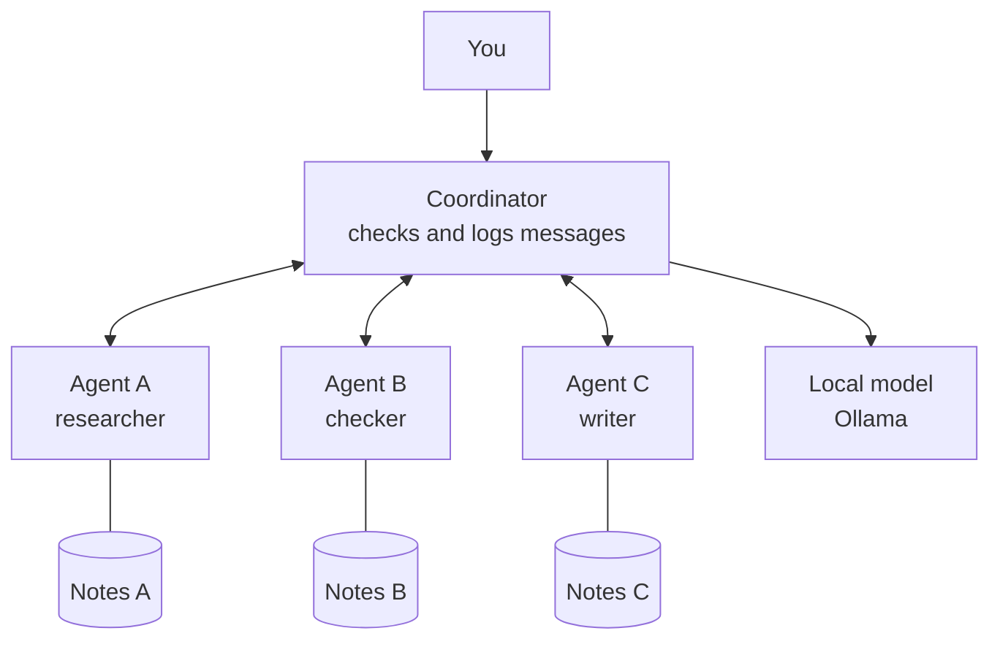

# Offline agents

A small team of AI agents that runs on your own computer.
It works with the internet switched off.
Each agent lives in its own locked box.
Each agent keeps its own private notes.
Agents can only talk through one coordinator, which checks and logs every message.

## How it works



- Agents cannot reach the internet.
- Agents cannot reach each other directly.
- Agents cannot reach the model directly. The coordinator asks it for them.
- Agents cannot see each other's notes.
- The file `coordinator/policy.json` says which agent may message which.

## What you need

- Docker Desktop
- Python 3.10 or newer
- Git
- About 4 GB of free disk space for the model

## Set it up (once, with internet)

```sh
git clone <your repo link>
cd offline-agents
./scripts/setup.sh
```

This makes secret tokens, downloads the model, and builds the boxes.
On Windows, run it inside Git Bash or WSL.

## Run it (internet can be off)

```sh
docker compose up -d
```

Send a task to an agent:

```sh
docker compose exec coordinator python ask.py agent_a "Explain how enzymes work"
```

Ask agent A to get help from agent B:

```sh
docker compose exec coordinator python ask.py agent_a "Write a fact, then ask agent_b to check it"
```

## Check the walls

Run this for each agent. Every line should say PASS.

```sh
docker compose exec agent_a python check_walls.py
```

## Read the log

```sh
docker compose exec coordinator cat /logs/messages.jsonl
```

## Run the tests (no Docker or model needed)

```sh
python -m unittest discover tests
```

## Change things

- Change an agent's job: edit `ROLE` in `docker-compose.yml`.
- Change who may talk to whom: edit `coordinator/policy.json`.
- Use a different model: change `MODEL` in `.env`, then run setup again.
- Add an agent: see `docs/adding-an-agent.md`.

## Stop it

```sh
docker compose down
```

## Project layout

```
coordinator/   the hub: routes tasks, calls the model, logs everything
agents/        the code every agent runs, plus the wall checker
scripts/       one-time setup
tests/         tests that run without Docker
docs/          team guides and research papers
```

## Background reading

See `docs/research.md` for papers and projects that use the same idea.
