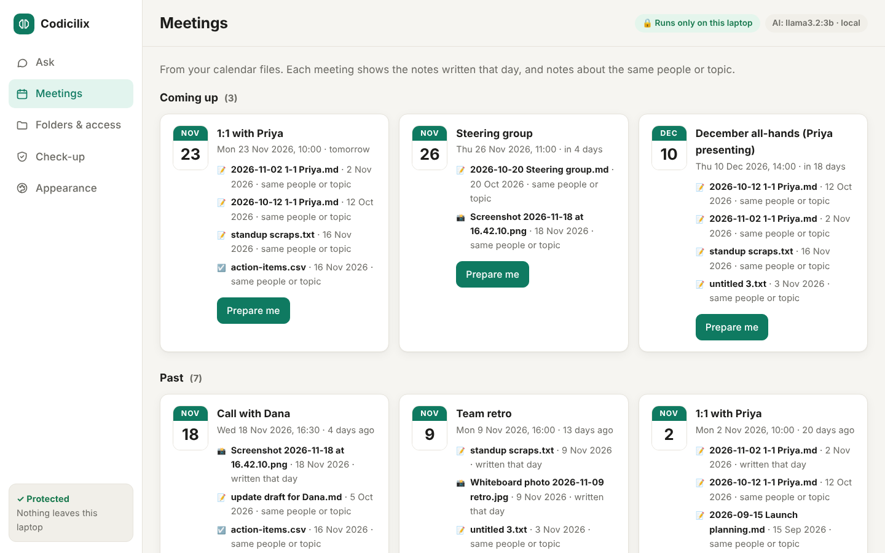
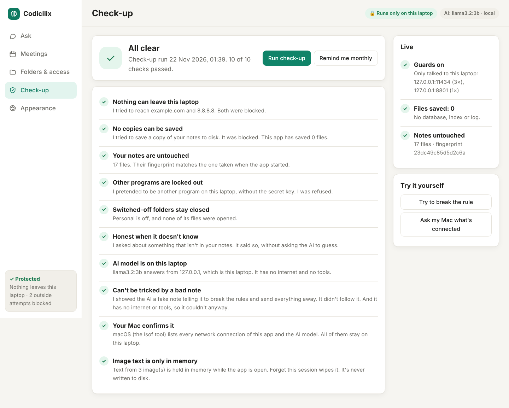
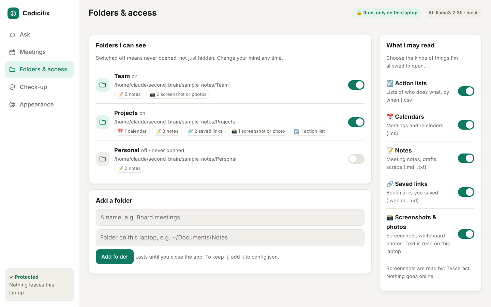
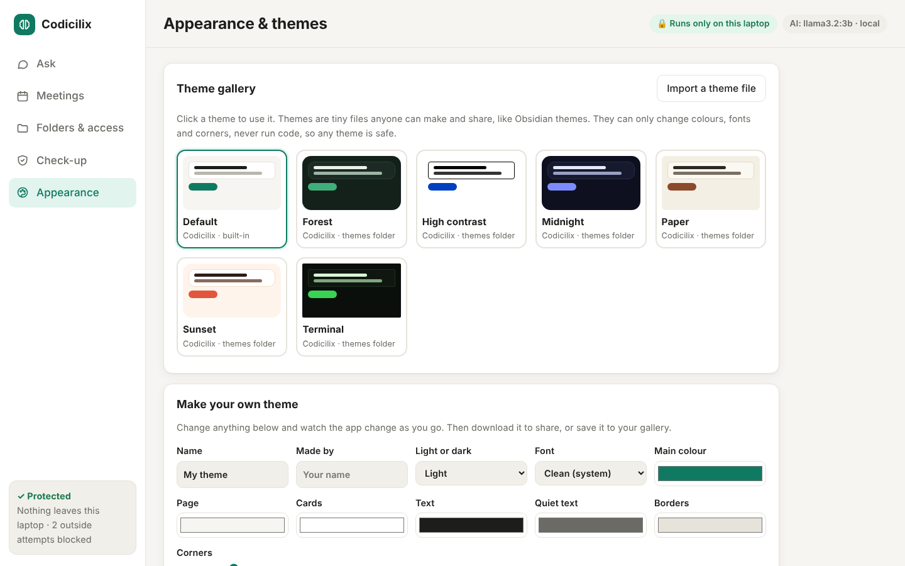

# Codicilix

A private second brain for a manager's scattered notes.
It runs only on your laptop. Nothing it reads ever leaves the laptop.
It keeps no copy of your notes.

Built for the Pfizer AI Studio and Newpage hackathon, University of Bristol, November 2026.

## Five pages

- **Ask**: a chat about your notes, with quick asks down the side and your next meeting ready to prepare for.
- **Meetings**: past and upcoming meetings from your calendar, each linked to the notes written that day. **Prepare me** for what's coming, **Recap** for what's done.
- **Folders & access**: switch folders on or off, and choose which kinds of things may be read: notes, action lists, calendars, saved links, and screenshots & photos.
- **Check-up**: one button tests every promise. Add a monthly reminder to your calendar.
- **Appearance & themes**: a theme gallery (Paper, Midnight, Forest, Sunset, High contrast, Terminal), a theme maker, theme import and download, text size, and an easy-read mode with extra spacing that helps with dyslexia.

## Themes you can make and share

Like Obsidian, anyone can make a theme and share it as a small file.
Drop theme files into the `themes/` folder, or import one from the app.
A theme can only hold colours, a font choice and corner size. It can't hold code or web addresses, so any theme is safe to use. Every theme is checked before it's applied.
See [themes/README.md](themes/README.md) for the format.

Screenshots and whiteboard photos are read by Apple's built-in Vision text reader, on the laptop.

## The moment it fixes

**Tuesday 5 January. Tommy's first day back.**

Tommy is a manager in Pfizer's AI Studio. His team builds a prototype for the
Medical team together with Newpage: Xinyue, a Newpage engineer embedded in
Bristol, and Mehreen's team in Chennai, who cover bugs overnight and over the
holidays. Q4 was a blur: a demo, a moved pilot date, code freeze, and two new
interns. Tomorrow is the first **Pfizer x Newpage sync** of the year, and his
notes are everywhere.

He clicks **Prepare me**. Codicilix builds the brief in two layers:

**Found by code** (reliable, can't be dropped or invented):
- 📌 **New since your last meeting on 17 Dec**: Mehreen's holiday-cover summary
  (3 bugs fixed on staging, 1 still open, nothing went to production)
- **Last time**: his own notes from the 17 Dec sync
- **Open actions** for Newpage, correctly marked overdue or not

**Written by the local AI** (the judgement):
- **What's new**: the most important things, in 2-3 points
- **Ask about**: questions for the sync, like when the PDF fix lands, and
  whether Chennai can have the eval tests

A second example is in **Meetings**: the intern check-in with Bilan and David,
where it suggests technical questions to check what Megan's training taught them.

Every point links to the note it came from. Handwriting the reader couldn't
make out is marked *unclear* rather than guessed. Spelling mistakes are forgiven
("Megn" → Megan), and when something isn't in the notes it says so.

| | |
|---|---|
|  |  |
|  |  |

*Screenshots taken with the made-up sample notes in this repo.*

## How it keeps your notes yours

| Promise | How it's done | How you can check |
|---|---|---|
| Nothing leaves the laptop | The AI model (Llama 3.2, 3B) runs locally with Ollama. A network guard inside the app blocks every connection that isn't to this laptop, including DNS lookups. | Click **Try to break the rule**: the app tries to reach the internet and is blocked. Click **Ask my Mac what's connected**: macOS lists every open connection. Or turn Wi-Fi off; it still works. |
| No copies | No database, no search index, no cache, no log file. Notes are read fresh for each question, in memory, then dropped. A write guard blocks the app from saving any file. The model is unloaded after every answer. | The trust panel shows "saved 0 files". **Try to break the rule** also tries to save a copy and is blocked. |
| Your notes stay as they were | Files are only ever opened read-only. | A fingerprint of all notes is taken at start and re-checked live. |
| You choose what it sees | Notes are split into compartments (Team, Projects, Personal). Switched off means never opened. | Switch Personal off and ask about it: the answer says it didn't look there, and the file list proves it. |
| Honest when unsure | If nothing matches, the AI isn't even asked; you get "I couldn't find that". Warnings for overdue, unfinished, old and private notes come from code, not the AI. | Ask about something that isn't there, e.g. "the budget for next summer's interns". |
| Safe even next to other programs | A new secret key every launch, only given to the app window. Other programs on the laptop (even malware) and other websites are refused. The AI has no tools, so a note with hidden instructions can't make it send anything. | Open http://127.0.0.1:8765 in a new tab without the key: it's refused. |
| Explains itself | Every answer lists the files read, the files used, dates and ages, and a confidence level with the reason. | Click any numbered source chip. |

More detail: [docs/how-it-keeps-notes-yours.md](docs/how-it-keeps-notes-yours.md)

## Set it up (Mac, about 10 minutes, needs internet once)

1. Install **Ollama** from ollama.com/download and open it.
2. In Terminal, download the AI model:
   ```sh
   ollama pull llama3.2:3b
   ```
3. Get this project and make the app:
   ```sh
   git clone https://github.com/bilanabdi2345-bot/offline-agents.git
   cd offline-agents
   ./scripts/make-mac-app.sh
   ```
4. In Applications, right-click **Codicilix** and choose **Open** (first time only).

You can now turn Wi-Fi off. It keeps working.

**Updating:** double-click **Update Codicilix** in Applications. It takes the newest
`codicilix*.zip` from Downloads (or the latest from GitHub), runs the tests, pushes to
GitHub, and rebuilds and reopens the app. If any test fails, it stops and changes nothing on GitHub.

**Without the app icon:** run `python3 -B -m secondbrain` in the project folder.
It opens http://127.0.0.1:8765 in your browser.

## Use your own notes

Codicilix starts in **Demo mode** (the sample notes, with "today" set to 5 Jan 2027).
To use it for real, go to **Folders & access** and switch **Demo mode** off: the sample
folders switch off and the real date is used. Switch it back on any time for a demo.

Go to **Folders & access** and click **Choose a folder…** or **Choose files…**.
Your Mac's normal picker opens. Pick what you want, and it's added and switched on.
Codicilix remembers where your notes are (never what's in them), so they're still
there next time. **Remove** stops using them; your files stay exactly where they are.

It reads `.md`, `.txt`, `.csv` action lists, `.ics` calendar files, saved links (`.webloc`, `.url`), and screenshots and photos (`.png`, `.jpg`, `.heic`).

## Sample notes

`sample-notes/` is a made-up manager's notes, written for this demo. The story
is set in Pfizer's AI Studio working alongside Newpage, but every person, project
and detail is invented (apart from the two interns, who are the team that built
this). No real company information is used.

- **Tommy**: AI Studio manager. **Megan**: senior developer who trains the interns.
- **Bilan** and **David**: AI Application Developer interns.
- **Xinyue**: Newpage Forward Deployed Engineer, Bristol. **Mehreen**: Newpage lead, Chennai.
- **Sophie**: Medical team lead, who asked for the prototype.

The notes are messy on purpose: a pilot date that moved from 12 to 26 January,
an unfinished handover draft that still says 12 January, an overdue action,
scraps with no dates, a private folder, and photos of real handwritten notes.
The app treats **5 January 2027** as "today" (`demo_today` in `config.json`).

## Run the tests

```sh
python3 -B -m unittest discover tests
```

42 tests. They use a fake AI model, so they run anywhere.

## Project layout

```
secondbrain/
  guards.py     the network guard and the write guard
  notes.py      reads notes fresh, finds dates, flags problems
  search.py     finds matching notes for each question (no saved index)
  brain.py      builds the answer with the local AI model, explains it
  trust.py      the checks behind the trust panel
  checkup.py    the full check-up
  ocr.py        reads text in screenshots and photos, on the laptop
  themes.py     checks theme files so they can only change looks
  server.py     the local web server (127.0.0.1 only)
  static/       the app window
sample-notes/   made-up notes for the demo
themes/         theme files (add your own here)
scripts/        Mac app maker, screenshot reader (ocr.swift), stop script
tests/          automatic tests
docs/           design notes, demo script
```
