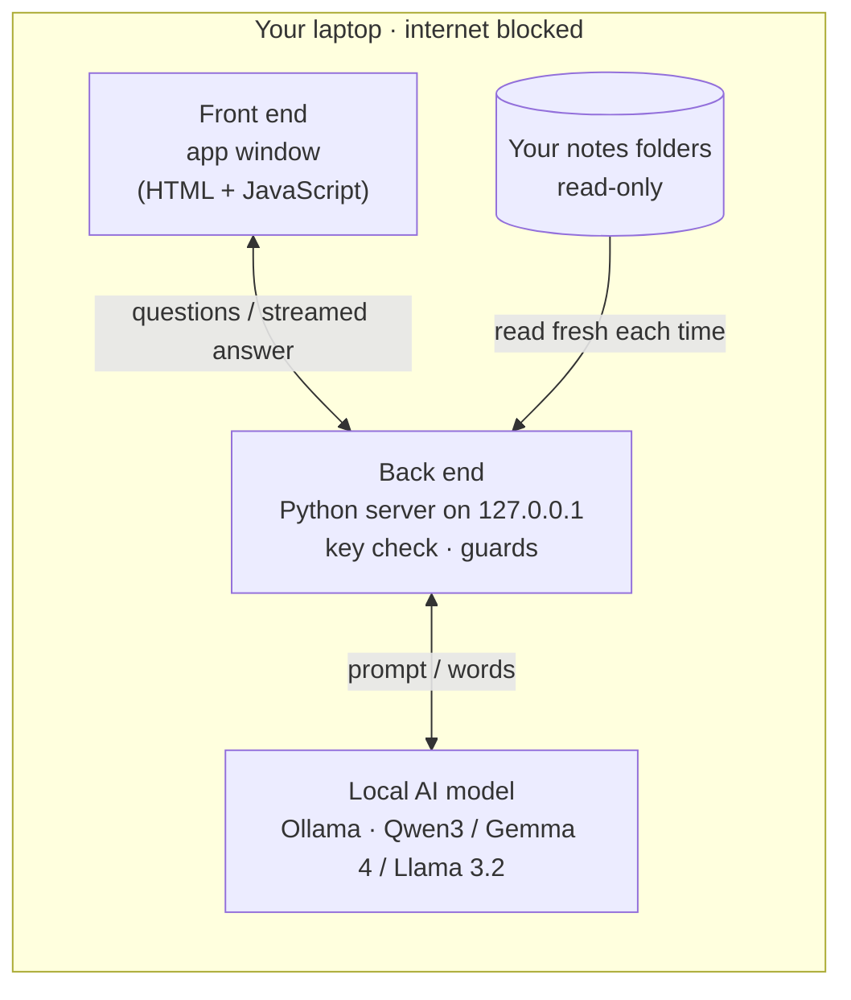

# How Codicilix is built

## Front end: `secondbrain/static/index.html`
One page, with no frameworks and no outside downloads, so it loads instantly and works offline.
- Folder switches (what the assistant may see)
- "Prepare me" for the next meeting, suggestion chips, and a question box
- The answer, with clickable source numbers, Watch out and Not in your notes boxes, confidence, and Read aloud
- The trust panel: live checks, "Try to break the rule", "Ask my Mac what's connected", and "Forget this session"

## Back end: `secondbrain/`
Plain Python, standard library only, so there is nothing to install.

| File | Job |
|---|---|
| `__main__.py` | Starts the guards first, makes this launch's secret key, starts the server |
| `guards.py` | Blocks every non-local connection and every file write |
| `server.py` | 127.0.0.1-only web server. Checks the key, Origin and Host |
| `notes.py` | Reads notes fresh, understands messy dates, adds warning flags |
| `search.py` | Scores notes for a question in memory (BM25, newer notes count more) |
| `brain.py` | Builds the prompt, streams the AI's answer, works out confidence |
| `trust.py` | Fingerprints the notes, and asks macOS (`lsof`) about connections |

## What happens when you ask (and how long it takes)

1. **Key check**: under 1 ms.
2. **Read the switched-on folders** fresh from disk: about 5 to 20 ms for hundreds of notes.
3. **Search** in memory: under 5 ms.
4. **Send sources to the window straight away.** You see which notes were found in about 0.1 seconds.
5. **The local AI writes the answer**, streamed word by word. On an M2 Mac with a 3B model, the first words arrive in about 1 to 3 seconds.
6. **Finish**: work out which sources were used and how confident to be. Then forget everything.

The only slow part is the AI writing, so the answer is streamed: you start reading straight away instead of waiting for the end.

## Choosing the model
`"model": "auto"` picks the best installed model for the Mac's memory: Qwen3 8B (16 GB+),
Qwen3 4B (8 GB), then Llama 3.2 3B. Thinking models get `"think": false`, because the code has
already found and organised the right notes; any thinking text that still appears is removed
before it reaches the chat (`secondbrain/models.py`).

## Making it faster if needed
- A smaller model, for example `llama3.2:1b`: faster, but less careful.
- In `config.json`, set `"model_keep_alive": "2m"` to keep the model loaded between questions. This saves about 1 to 2 seconds a question. The trade-off is that the model stays in memory for 2 minutes instead of unloading at once, so we left it at `"0"`.
